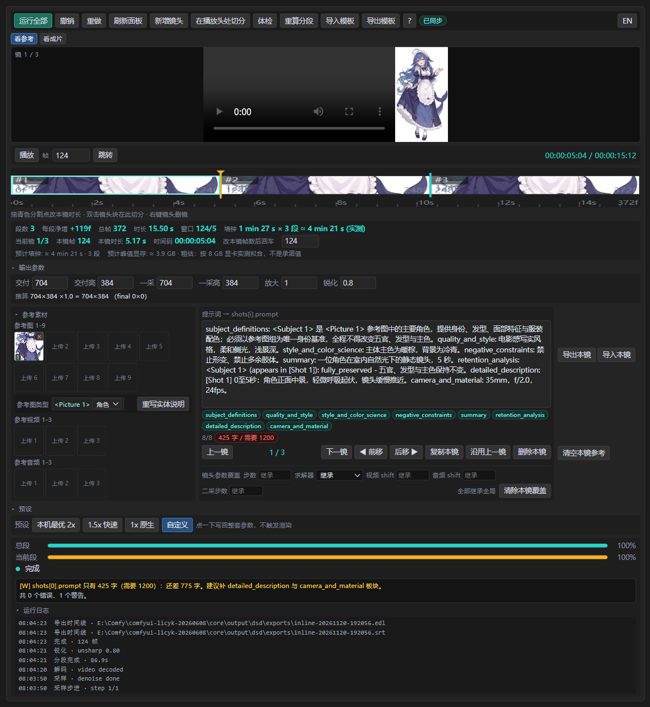

# ComfyUI DSD Director

ComfyUI 多镜头导演节点：**镜头表写在节点内**，参考图 / 参考视频 / 参考音频直接在面板里拖进来，一采加可选潜空间超采样，出片同时导出 SRT + EDL 时间线。

不做纯文生视频——它只做「以参考素材为身份基准的多镜头续接」，因为 MiniMax H3 的 Ref2V 能力就是为此设计的。



## 为什么要有它

MiniMax H3 单次生成大约 124 帧（24 fps 约 5.17 秒）。要做几分钟的成片，必须把一个长镜头切成若干段、逐段续接，且每段接缝要对得上。手工做很痛：

- 分段窗口必须落在 `17k+5` 栅格上（124 / 141 / 158 …），随便填数字模型直接拒绝；
- 后一段要拿前一段的潜空间做 handoff，否则接缝闪；
- 参考素材要按 `<Picture N>` / `<Video K>` / `<Audio J>` 编号并在提示词里对应上；
- 交付尺寸、潜空间超采样倍数、锐化量三者会互相打架。

这个节点把这些约束收进 UI：你在面板里排镜头、拖素材、写提示词，节点内部组装成渲染计划交给内核执行。**运行链路不读写任何 plan 文件**——早期版本是「先写 JSON 再让 widget 覆盖」，方向反了，已推翻（见 [docs/80](docs/80-director-node-redesign.md)）。

## 目录结构

```
comfyui-dsd-director/
├── __init__.py              ComfyUI 扩展入口（注册节点 + 静态资源 + HTTP 路由）
├── pyproject.toml           ComfyUI Registry 元数据
├── dsd_nodes/
│   ├── nodes.py             5 个节点：导演台 + 计划检查器 + 提示词 + 素材中心 + 音视频解码
│   └── routes.py            POST /dsd/preflight（提交前体检）
├── dsd/                     渲染内核，随包自带（vendored）
├── web/js/dsd_director.js   导演台面板（面板全部交互都在这一个文件里）
├── workflows/               8 件示例工作流（中文 + 英文别名，ui + api）
├── scripts/sync_kernel.py   内核副本与开发源的一致性检查
└── docs/                    设计、契约、验收与发布文档
```

渲染内核随包自带，`import dsd` 的解析顺序：

1. 环境变量 `DSD_SRC`（如果你有独立开发副本）；
2. 包内 `dsd/`（默认，clone 下来就能跑）；
3. `~/Documents/deepseek-harness/default-workspace/film-pipeline/src`（作者本机的兜底，别人机器上不存在）。

详见 [VENDOR.md](VENDOR.md)。

## 安装

1. 放进 ComfyUI 的 `custom_nodes/`：

```bash
cd ComfyUI/custom_nodes
git clone https://github.com/cxin21/comfyui-dsd-director.git dsd-director
```

2. 装模型（下表，合计约 50 GB），按 ComfyUI 常规目录摆放。

3. 重启 ComfyUI。**首次安装、以及每次更新扩展代码后，都要在浏览器按 `Ctrl+Shift+R` 硬刷新**——扩展 JS 会被缓存，只按 F5 可能还跑旧版，表现为「节点在、面板是空的」。

4. 打开 `workflows/DSD导演台v2-最优一采+2x超采样.json`，拖一张参考图进去，点「体检」，再点「运行全部」。

> 只在 ComfyUI 0.45.0 + PyTorch 2.12.1+cu130 实测过。更老的版本缺 `BDGROUP` 与 Autogrow，面板会退化成裸 widget 列表。

## 模型依赖

| 用途 | 文件 | 目录 | 大小 |
|---|---|---|---|
| 底模 | `minimax_h3_hybrid_fl2va_ref2va_b25-49-int8_r*.safetensors` | `models/diffusion_models/MiniMax/` | 约 20.97 GB |
| 4 步蒸馏 LoRA | `minimax_h3_fl2v_turbo_4step_v1.2_768p_comfyui_bf16.safetensors` | `models/loras/MiniMax/` | 约 1.8 GB |
| 风格 LoRA | `pika_h3_flex_turbo_4step_ref2va*.safetensors` | `models/loras/MiniMax/` | 约 1.8 GB |
| 锐度 LoRA | `minimax_h3_lms_v1.0_r64*.safetensors` | `models/loras/MiniMax/` | 约 1.8 GB |
| 文本编码器 | `qwen3vl_32b_minimax_h3_nvfp4_awq.safetensors` | `models/text_encoders/` | 约 18 GB |
| 视频 VAE | `minimax_h3_video_vae_fp16.safetensors` | `models/vae/` | 约 2 GB |
| 音频 VAE | `minimax_h3_audio_vae_fp32.safetensors` | `models/vae/` | 约 0.5 GB |
| 潜空间上采样 | `minimax_h3_latent_upscaler_3d_conv_v1_bf16.safetensors` | `models/latent_upscale_models/` | 约 0.4 GB |

`steps` 默认 4 不是随便定的：4 步 turbo LoRA 是蒸馏件，只在 4 步域内成立。改成 1 步会得到线条发散的分布外画面（隔离实验见 [docs/87](docs/87-director-ui-v2-3-full-sweep.md)）。

## 三件示例工作流

节点链与参考槽完全一样，只差解码档位。按用途挑一件：

| 工作流 | 一采画布 | 超采样 | 交付 | 单段墙钟 | 用途 |
|---|---|---|---|---|---|
| `DSD导演台v2-纯一采直出1376x768.json` | 1376×768 | 关 | 1376×768 | 约 700 s | 画质基线、对照件、省显存 |
| `DSD导演台v2-最优一采+2x超采样.json` | 1376×768 | 2x | 2560×1440 | 约 906 s | 主力交付 |
| `DSD导演台v2-快速验证1步.json` | 1376×768 | 1.25x | 1712×960 | 约 120 s | 1 步冒烟，画质不交付 |

单段指 124 帧。3 分钟的片子约 37 段，按上表推算 7.4–9.3 小时——这是当前硬限制，不是配置问题。

每件都有 `-api.json`（脚本提交用）与英文别名（`DSD-director-v2-*.json`）；中英文名文件逐字节相同。

## 面板速查

| 区域 | 能做什么 |
|---|---|
| 工具栏 | 运行全部（带体检守卫）、刷新、新增镜头、在播放头处切分、体检、重算分段、导入/导出模板、语言切换 |
| 预览台 | 「看参考」播当前镜素材，「看成片」播上一次渲染结果 |
| 时间轴 | 秒标尺 + 镜头缩略图；拖拽重排、拖右边缘改时长、双击任意位置切分、右键删除 |
| 摘要条 | 总段数 / 每段净增帧 / 总帧 / 总时长 / 窗口 / 墙钟（跑过就用实测值）；第二行是当前镜的帧数、时长、时间码，可直接改帧数 |
| 输出条 | 一采尺寸、超采样倍数、交付尺寸、锐化；实时推算 `gen × mult = final`，不一致就红字提示 |
| 镜头卡 | 9 参考图槽 + 3 视频 + 3 音频（点击或拖拽上传）；参考图类型（角色/背景/道具/风格/其他）→「重写实体说明」自动生成 `<Subject N>` 骨架行，幂等；提示词 8 板块检查器 + 字数表；镜头级参数覆盖 |
| 预设条 | 本机最优 2x / 1.5x 快速 / 1x 原生 / 自定义 |
| 状态区 | 两条真进度条（总段 + 当前段）、体检结果、运行日志 |

快捷键：`Space` 播放暂停 · `←/→` 切镜 · `Shift+←/→` 跳 1 秒 · `Delete` 删镜（先确认）· `Ctrl+Enter` 运行 · `Ctrl+Z / Ctrl+Shift+Z` 撤销重做 · `F1` 帮助。

## 参数分三层

**一、内置常量**（面板只读显示）：`24 fps` · `音频 40 Hz` · `音视频时间比 5:3` · `画布必须 32 的倍数` · `窗口 17k+5` · `vae_tile 0` · `decode_shifts 空` · `partial_start 0` · `seam_min 0.1`。不是懒得做控件，是动了会坏：窗口不在 17k+5 栅格上模型直接拒绝；`vae_tile` 非 0 会在解码里烧进 16 px 网格与 17 帧暗脉冲。

**二、参数可控**（六组，都在节点 widget 上）：

| 组 | 参数 | 默认 | 说明 |
|---|---|---|---|
| 顶层 | `seed` | 2609198601 | 带 `control_after_generate` |
| 顶层 | `preset` | 本机最优 2x | 四档预设，见下 |
| 顶层 | `strict` | true | 提示词过短 / 几何非法时抛错，关掉只警告 |
| 顶层 | `budget_gib` | 7.9 | 显存预算，超了自动降 tile |
| 采样 | `steps` / `solver` | 4 / euler | solver 可选 `euler` / `exp2` |
| 采样 | `shift_video` / `shift_audio` | 12.0 / 3.0 | 双时钟 sigma 偏移 |
| 采样 | `handoff` | latent_prefix | 段间接力方式，另有 ramp / anchor |
| 几何 | `gen_w` / `gen_h` | 1376 × 768 | 一采画布，必须 32 的倍数 |
| 几何 | `window_frames` | 124 | 每段窗口，17k+5，取值 [124, 362] |
| 几何 | `context_frames` | 5 | 段间引导帧，5 / 22 / 39 |
| 几何 | `ffn_chunks` | 4 | 前馈分块，只影响峰值显存，不影响像素 |
| 几何 | `tile_size` | 512 | 解码分块边长 |
| 超采样 | `pass2` | true | 关掉 = 一采直出 |
| 超采样 | `upscale` | 2.0 | 1.0 / 1.25 / 1.5 / 2.0 |
| 超采样 | `final_w` / `final_h` | 0（自动） | 0 表示按倍数推算并对齐 32 |
| 超采样 | `pass2_steps` | 0 | 0 = 只放大不重绘（本项目默认）；>0 = 真二采 |
| 超采样 | `pass2_sigma` | 0.0 | 二采起始 sigma |
| 交付 | `out_w` / `out_h` | 2560 × 1440 | 最终交付尺寸，自由缩放 |
| 交付 | `unsharp` | 0.8 | 原生分辨率上的 5×5 反锐化，0 = 关 |
| 交付 | `export_mode` | frames | `frames` / `frames+report` / `frames+timeline` |
| 模板 | `plan_path` | 空 | 非空时把旧 plan JSON 当模板导入一次 |

### 预设四档（只是「填表」）

| 预设 | steps | 一采画布 | 超采样 | 交付 | unsharp | 单段墙钟（124 帧） |
|---|---|---|---|---|---|---|
| 本机最优 2x | 4 | 1376×768 | 2.0 → 2752×1536 | 2560×1440 | 0.8 | 906 s |
| 1.5x 快速 | 4 | 1376×768 | 1.5 → 2048×1152 | 1920×1080 | 0.8 | 882 s |
| 1x 原生 | 4 | 1376×768 | 关 | 1376×768 | 0.0 | 1080 s |
| 自定义 | 手填 | 手填 | 手填 | 手填 | 手填 | — |

点预设会把上表的值写进控件；之后手改不会被静默覆盖——后端只做比对，不一致时在 report 里记 `preset=… (overridden)` 并给一条警告，按你手填的值执行。

**三、预设**：预设按钮只**填表**，不锁死。点完之后你手动改过 widget，执行时按你改的值跑，并在报告里记 warning——早期版本是无条件覆盖，手改会被静默吞掉。

## 五个节点

| 节点 | 作用 |
|---|---|
| **DSD Director（导演台·一键长片）** | 主力节点，面板 + 渲染全在这里 |
| DSD Plan Inspector（计划校验） | 读一份旧 plan JSON 做结构校验（迁移期用） |
| DSD Shot Prompt（镜头提示词） | 从 plan JSON 里取某一镜的提示词 / 时长 |
| DSD Resource Hub（素材中心） | 列出 `input/` 里可用的参考素材 |
| DSD Decode AV（音视频解码） | 把出片解成帧与音频两路，便于后续处理 |

## 时间线导出

`export_mode = frames+timeline` 时，出片同时写 `<output>/dsd/exports/<plan-id>-<时间戳>.srt` 与 `.edl`（CMX3600，24 fps 时间码）。每段带该段实际参数（`steps=4 shift=12.0/3.0`），方便回查这一镜是怎么跑出来的。

## 提交前体检

点「体检」走 `POST /dsd/preflight`，纯静态检查、不触发渲染、不占 GPU，19 个检查码（9 错误 + 10 警告）：参考素材缺失、提示词过短、窗口不在栅格上、画布不是 32 倍数、`<Picture N>` 引用了不存在的图、各段提示词重复、主体编号顺序异常等。

`strict=true` 时后端硬校验与体检同源，体检能过的基本不会被渲染器拒。

## 镜头级参数覆盖

每镜可单独覆盖 `steps` / `solver` / `shift_video` / `shift_audio` / `pass2_steps`，留空即继承全局。序列化进 `timeline_data` 的 `overrides` 字段，导出 SRT/EDL 时逐段写出实际生效值。

## 已知限制

- **单段约 700–906 s（124 帧）**，几分钟的片子是小时级。想快只能降步数或降尺寸，两者都掉画质。
- 面板中文；英文界面是完整翻译，提示词模板措辞随语种切换。实体模板只覆盖骨架行，正文还得自己写。
- `ref_video_audios`（视频自带音轨配对）未接，参考视频的音轨要单独作为参考音频上传。
- 1 步只用于冒烟；4 步是蒸馏 LoRA 训练域。2–3 步没有系统评过。
- 二采用 3D conv 潜空间上采样 + 少步 refine，不是重绘；收益在细节与锐度，不在内容。

## 开发

渲染内核 `dsd/` 是 vendored 副本，源在作者开发仓库。两边同步：

```bash
python scripts/sync_kernel.py           # 复制源 → 包内，并打印 sha256 对照
python scripts/sync_kernel.py --check   # 只比较，不一致退出码 1
```

提 PR 前请跑：

```bash
python -m py_compile dsd_nodes/nodes.py dsd_nodes/routes.py
node --check web/js/dsd_director.js
python scripts/sync_kernel.py --check
```

给面板 JS 打补丁有个坑值得记下来：**字符串字面量里的换行必须写成转义的 `\n`**。写成真换行时 `node --check` 会通过，但浏览器 `import` 抛 `SyntaxError: Invalid or unexpected token`，整个扩展静默不执行——表现为「节点在、面板完全空」。验语法请用 `node --check` **加**浏览器里实际 `createNode` 数 widget。

## 文档

| 文档 | 内容 |
|---|---|
| [docs/80](docs/80-director-node-redesign.md) | 节点重设计：为什么把数据源从 plan 文件搬进节点 |
| [docs/81](docs/81-widget-contract.md) | widget 硬合同（required 8 + optional 31 逐位） |
| [docs/83](docs/83-director-v2-verification.md) | v2 验收：内联时间线、参考素材三路、真进度协议 |
| [docs/84](docs/84-director-ui-v2-1.md) | v2.1：实体类型模板、当前镜帧数、1.5x 几何修正 |
| [docs/85](docs/85-director-v2-2-preflight-overrides-export.md) | v2.2：体检、镜头级覆盖、SRT/EDL 导出 |
| [docs/86](docs/86-director-release-v2.2.0.md) | v2.2 发布验收与内核 vendoring |
| [docs/87](docs/87-director-ui-v2-3-full-sweep.md) | v2.3：14 项面板交互、四档预设对照、steps/ffn 隔离实验 |
| [docs/88](docs/88-onepass-1376x768-workflow.md) | 纯一采直出 1376×768 工作流 |
| [VENDOR.md](VENDOR.md) | 内核副本的解析顺序与防漂移约定 |

## 与其他 MiniMax H3 导演面板的关系

同为 MiniMax H3 多镜头面板，思路不同：以分段 LoRA 与素材库为中心的方案，和我们把镜头表、参数覆盖、时间线导出收进一个节点的方案，没有依赖关系也没有共享代码。

## License

MIT，见 [LICENSE](LICENSE)。可商用、闭源分发、二次修改，保留版权声明即可。

MiniMax H3 的模型权重有自己的许可，不属于本仓库。